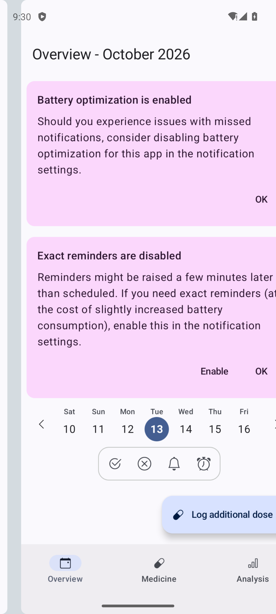

# Reconocimiento 5.4 - David López Callejón

Análisis del 13/10/2026. Dominio del grupo: Salud. MedTimer gestiona recordatorios y registro de medicación; se consultó su [ficha de Google Play](https://play.google.com/store/apps/details?id=com.futsch1.medtimer) y se instaló el **APK full firmado del release oficial de GitHub**. No se obtuvo el archivo desde Play ni se afirma que sea idéntico al conjunto servido por la tienda.

## Artefacto y entorno

- [Release oficial v1.26.0](https://github.com/Futsch1/medTimer/releases/tag/v1.26.0), publicado el 09/10/2026. [Archivo del autor](https://github.com/Futsch1/medTimer/releases/download/v1.26.0/MedTimer-full-release-signed.apk).
- Paquete `com.futsch1.medtimer`, versión `1.26.0`, versionCode `187`; minSdk `28`, targetSdk `36`, compilado contra API `37`.
- AVD dedicado Pixel 6 ARM64, Android 14/API 34, parche `2023-09-05`; serial `emulator-5580`. Es el entorno observado, no un dispositivo actualizado.
- ADB `1.0.41 / 37.0.0-14910828`; apktool `3.0.1`; Build Tools `36.0.0`; aapt2 `2.20-13193326`; apksigner `0.9`; JDK `25.0.2`.
- Instalación `Success`; lanzamiento `Status: ok`, primero con onboarding y después con la pantalla principal. Sin datos de medicación, cuentas, biometría ni ubicación; se rechazó la solicitud de notificaciones.
- Una sola pieza instalada, `base.apk`, sin splits. Se extrajeron **todas** las rutas de `pm path`; descarga y pieza extraída coinciden en SHA-256.

Tamaño: `15484781` bytes. SHA-256 del APK instalado/extraído: `e92c955e54a62262d0b776259faf6b04a2070bbf5920f38f1fa0db2d3aaf4330`. El mapeo exacto ruta instalada -> archivo -> hash está en [piezas.json](evidencias/piezas.json).

## Firma observada

`apksigner verify --print-certs -v` termina con código 0 y `Verifies`. Verifica **v3**; v1, v2, v3.1, v4 y SourceStamp aparecen `false` en esta verificación. No se infiere una firma v4 separada ausente del material descargado. Un firmante: `C=49, ST=BW, L=Stuttgart, CN=Florian Fetz`, RSA de 2048 bits. SHA-256 del certificado: `69bc7c72e499045b44c87fc8463f599472deb408c48de38de8554ae7754b9d84`.

## Permisos declarados y estado

Hay **14 uses-permission** y dos declaraciones `permission` propias; no se cuentan estas últimas como solicitudes adicionales. Niveles de protección obtenidos de `dumpsys package permissions` en API 34, contrastados con el manifiesto. `granted` indica el estado de PackageManager en la inspección; para accesos especiales, AppOps y ajustes pueden imponer controles adicionales aunque figure `true`.

| Permiso (prefijo android.permission salvo los propios) | Protección observada API 34 | granted | Justificación / límite |
| --- | --- | --- | --- |
| `ACCESS_COARSE_LOCATION` | `dangerous|instant` | `false` | Posponer por ubicación y volver a avisar al llegar a casa, descrito en Play y en la variante full del autor. |
| `ACCESS_FINE_LOCATION` | `dangerous|instant` | `false` | Geofencing de la función de posposición por ubicación; no se probó concediendo ubicación. |
| `ACCESS_BACKGROUND_LOCATION` | `dangerous|instant` | `false` | Detectar llegada a casa con la app en segundo plano (inferencia de la función documentada); minSdkVersion=29 en esta declaración. |
| `POST_NOTIFICATIONS` | `dangerous|instant` | `false` | Avisos de medicación; petición observada y rechazada durante el reconocimiento. |
| `SCHEDULE_EXACT_ALARM` | `signature|privileged|appop` | `false` | Recordatorios puntuales; la interfaz advierte que los recordatorios exactos están desactivados. |
| `RECEIVE_BOOT_COMPLETED` | `normal` | `true` | Reprogramación tras reinicio; receptor Autostart declarado, no se probó el reinicio. |
| `com.futsch1.medtimer.NOTIFICATION_PROCESSED` | `normal` | `true` | Comunicación del procesamiento de avisos con ReminderProcessorBroadcastReceiver, que además está exported=false. Nivel normal por omisión, confirmado en el dispositivo. |
| `ACCESS_NOTIFICATION_POLICY` | `normal` | `true` | Alarmas y avisos con modo silencio/No molestar (inferencia de la función descrita); no se concedió acceso especial a No molestar. |
| `USE_FULL_SCREEN_INTENT` | `normal|appop` | `true` | Pantalla de alarma ReminderAlarmActivity; el nivel normal|appop no garantiza autorización efectiva de pantalla completa. |
| `VIBRATE` | `normal|instant` | `true` | Vibración de los avisos, coherente con recordatorios; no se generaron avisos con medicación. |
| `REQUEST_IGNORE_BATTERY_OPTIMIZATIONS` | `normal` | `true` | La interfaz sugiere desactivar la optimización de batería ante avisos perdidos; no se activó esa exención. |
| `USE_BIOMETRIC` | `normal` | `true` | Protección de acceso; el código oficial Biometrics.kt del tag usa BiometricPrompt. No se configuró biometría. |
| `USE_FINGERPRINT` | `normal` | `true` | Compatibilidad biométrica heredada, coherente con la dependencia; está obsoleto desde API 28 y minSdk=28, por lo que merece revisar su necesidad concreta. |
| `com.futsch1.medtimer.DYNAMIC_RECEIVER_NOT_EXPORTED_PERMISSION` | `signature` | `true` | Permiso signature de infraestructura AndroidX para receptores dinámicos; no es permiso de salud solicitado al usuario. |

Las cuatro solicitudes peligrosas (ubicación aproximada, precisa, en segundo plano y notificaciones) permanecen denegadas. `SCHEDULE_EXACT_ALARM` figura denegado; la app sigue abriendo. `ACCESS_NOTIFICATION_POLICY` y `REQUEST_IGNORE_BATTERY_OPTIMIZATIONS` figuran concedidos como permisos normales, pero eso no equivale a haber concedido acceso a No molestar o a haber desactivado la optimización. AppOps observado: ubicación y notificación en `ignore`.

**Permiso difícil de justificar:** la ubicación en segundo plano sería desproporcionada para simples recordatorios horarios, pero aquí existe una función documentada de geofencing. No se observa un permiso claramente ajeno a la función; `USE_FINGERPRINT` merece revisión por su obsolescencia y minSdk 28, sin deducir una vulnerabilidad por ello. El reconocimiento no verifica el uso efectivo de cada permiso.

## Componentes declarados y exportación

Se revisaron todos los tipos: **5 activities, 8 receivers, 2 services, 2 providers y 0 activity-alias**, total **17**. Hay **3 exportados**, todos con `exported=true` explícito y habilitados efectivamente:

1. `com.futsch1.medtimer.MainActivity`: entrada MAIN/LAUNCHER, sin permiso de componente.
2. `androidx.compose.ui.tooling.PreviewActivity`: pantalla de tooling exportada, sin permiso. Su presencia en el release merece revisión; no se invocó ni se demuestra explotación.
3. `androidx.profileinstaller.ProfileInstallReceiver`: protegido por `android.permission.DUMP` (signature|privileged|development en el AVD); no es acceso libre para una app ordinaria.

| Tipo | Nombre | exported declarado / efectivo | enabled efectivo | Permiso del componente |
| --- | --- | --- | --- | --- |
| activity | `com.futsch1.medtimer.MainActivity` | true / true | true | `ninguno` |
| activity | `com.futsch1.medtimer.MedTimerAppIntro` | ausente / false | true | `ninguno` |
| receiver | `com.futsch1.medtimer.Autostart` | false / false | true | `android.permission.RECEIVE_BOOT_COMPLETED` |
| receiver | `com.futsch1.medtimer.TimeChangeReceiver` | false / false | true | `ninguno` |
| provider | `androidx.core.content.FileProvider` | false / false | true | `ninguno` |
| service | `com.futsch1.medtimer.feature.reminders.ReminderSchedulerService` | false / false | true | `ninguno` |
| activity | `com.futsch1.medtimer.feature.reminders.alarm.ReminderAlarmActivity` | false / false | true | `ninguno` |
| receiver | `com.futsch1.medtimer.feature.reminders.ReminderProcessorBroadcastReceiver` | false / false | true | `com.futsch1.medtimer.NOTIFICATION_PROCESSED` |
| receiver | `com.futsch1.medtimer.feature.reminders.widgets.NextRemindersWidgetProvider` | false / false | true | `ninguno` |
| receiver | `com.futsch1.medtimer.feature.reminders.widgets.LatestRemindersWidgetProvider` | false / false | true | `ninguno` |
| receiver | `com.futsch1.medtimer.feature.reminders.widgets.WidgetUpdateReceiver` | false / false | true | `ninguno` |
| activity | `androidx.compose.ui.tooling.PreviewActivity` | true / true | true | `ninguno` |
| receiver | `com.futsch1.medtimer.core.location.GeofenceBroadcastReceiver` | false / false | true | `ninguno` |
| provider | `androidx.startup.InitializationProvider` | false / false | true | `ninguno` |
| activity | `com.google.android.gms.common.api.GoogleApiActivity` | false / false | true | `ninguno` |
| service | `androidx.room.MultiInstanceInvalidationService` | false / false | true | `ninguno` |
| receiver | `androidx.profileinstaller.ProfileInstallReceiver` | true / true | true | `android.permission.DUMP` |

Reglas: se respeta el atributo explícito. `MedTimerAppIntro` no tiene `exported` ni filtros, por lo que su valor efectivo es false. En activities/services/receivers sin declaración, se considera la presencia de filtros y el requisito de declaración explícita al apuntar a API 31+; no hay otro caso omitido aquí. Providers sin declaración serían no exportados para targetSdk >=17 (estos dos lo declaran false). enabled combina el valor de la aplicación y el del componente, ambos true por omisión salvo declaraciones explícitas; no se observaron anulaciones de componentes en PackageManager. Se inspeccionó permiso heredado de application: ausente. No hay activity-alias ni readPermission/writePermission/path-permission que alteren este listado. `grantUriPermissions=true` del FileProvider permite concesiones URI específicas aunque exported sea false.

## Procedimiento reproducible

Con el AVD seleccionado y las Build Tools 36.0.0 disponibles:

```sh
adb -s emulator-5580 install MedTimer-full-release-signed.apk
adb -s emulator-5580 shell am start -W -n com.futsch1.medtimer/.MainActivity
adb -s emulator-5580 shell pm list packages com.futsch1.medtimer
adb -s emulator-5580 shell pm path com.futsch1.medtimer
# Por cada línea package:, retirar solo el prefijo y hacer pull de esa ruta.
adb -s emulator-5580 pull '<ruta real devuelta por pm path>' base.apk
shasum -a 256 base.apk MedTimer-full-release-signed.apk
"$BT/aapt2" dump permissions base.apk
"$BT/aapt2" dump badging base.apk
"$BT/apksigner" verify --print-certs -v base.apk
apktool d -o decodificado base.apk
adb -s emulator-5580 shell dumpsys package com.futsch1.medtimer
adb -s emulator-5580 shell dumpsys package permissions
adb -s emulator-5580 shell cmd appops get com.futsch1.medtimer
```

El intento `pm list permissions -f` devolvió 255 por un fallo del listado de etiquetas del sistema; se usó `dumpsys package permissions`, que terminó con código 0, para conocer los niveles. Se guardaron las salidas completas localmente y se publican extractos seleccionados. No se explotan componentes de terceros ni se publican sus APK o decodificados completos.

## Evidencias y referencias

- [Permisos](evidencias/permissions.txt), [badging](evidencias/badging.txt), [firma](evidencias/firma.txt), [pm path](evidencias/pm-path.txt), [manifiesto](evidencias/AndroidManifest.xml), [estado concedido](evidencias/permisos-concedidos.txt), [AppOps](evidencias/appops.txt).
- [Inventario de componentes](evidencias/componentes.json), [niveles de permisos](evidencias/permisos.json), [piezas y hash](evidencias/piezas.json), [instalación](evidencias/instalacion.txt), [lanzamiento](evidencias/lanzamiento.txt).
- Funciones y variante: [README oficial del tag](https://github.com/Futsch1/medTimer/blob/v1.26.0/README.md); biometría: [Biometrics.kt](https://github.com/Futsch1/medTimer/blob/v1.26.0/app/src/main/java/com/futsch1/medtimer/Biometrics.kt). Las justificaciones inferidas se identifican en la tabla.
- Reglas Android: [activity/exported](https://developer.android.com/guide/topics/manifest/activity-element#exported), [provider/exported](https://developer.android.com/guide/topics/manifest/provider-element#exported), [niveles de permission](https://developer.android.com/guide/topics/manifest/permission-element#plevel), [referencia de permisos](https://developer.android.com/reference/android/Manifest.permission).



El trabajo de David completa 5.4. Ratificación de convenciones, asignación de responsables de funcionalidades y confirmación de accesos del profesorado e integrantes siguen pendientes del equipo.
